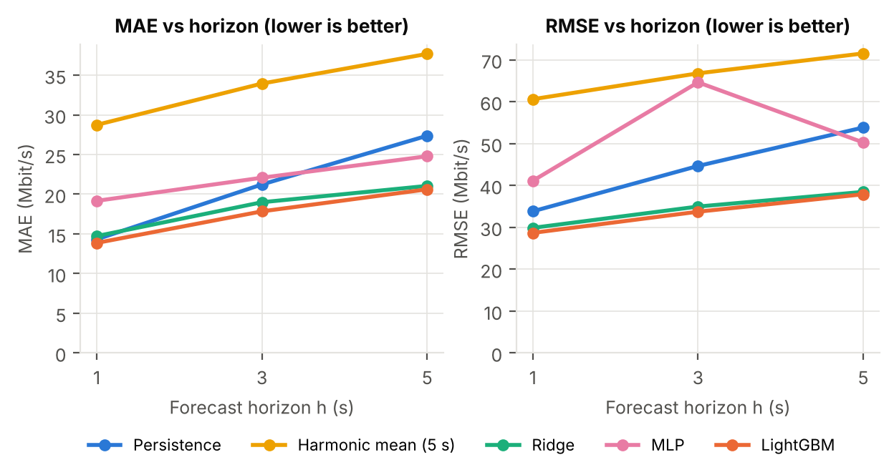
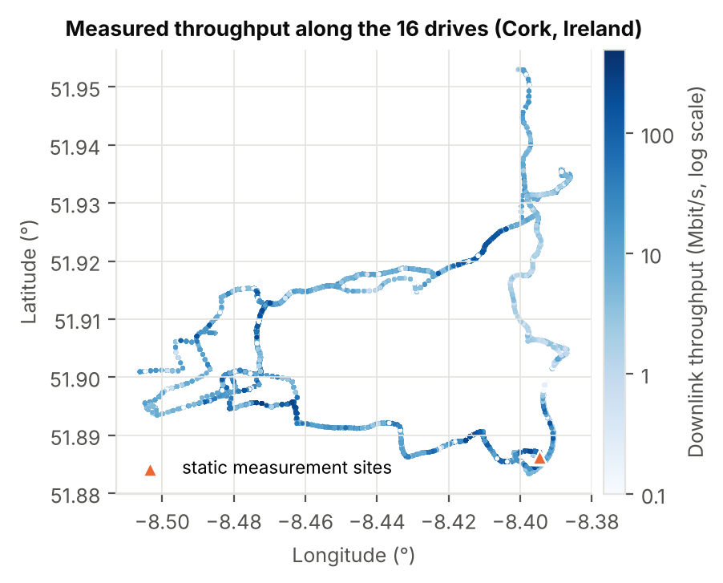
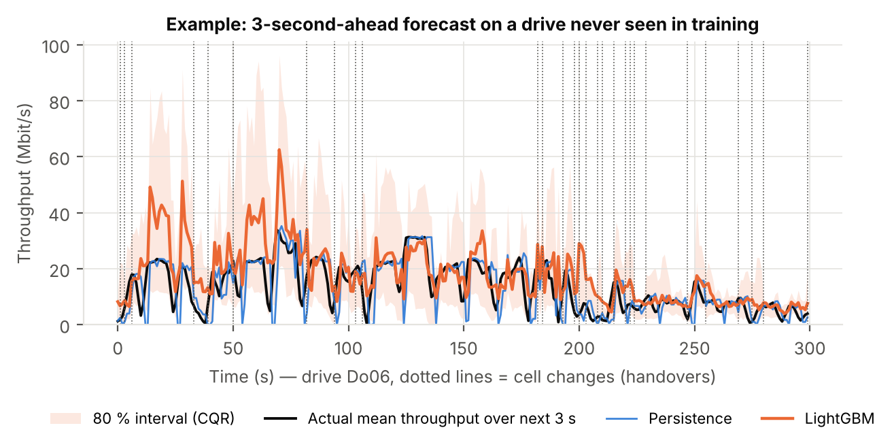
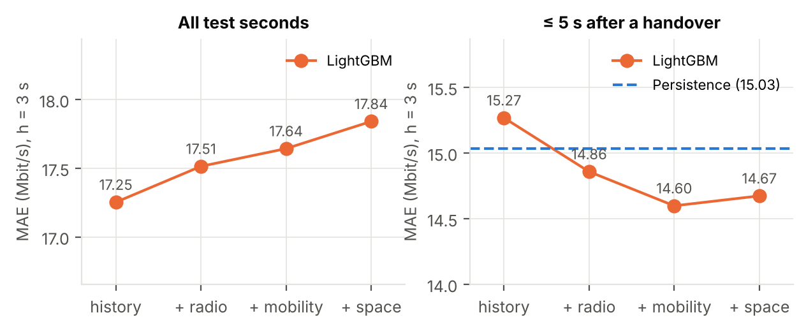
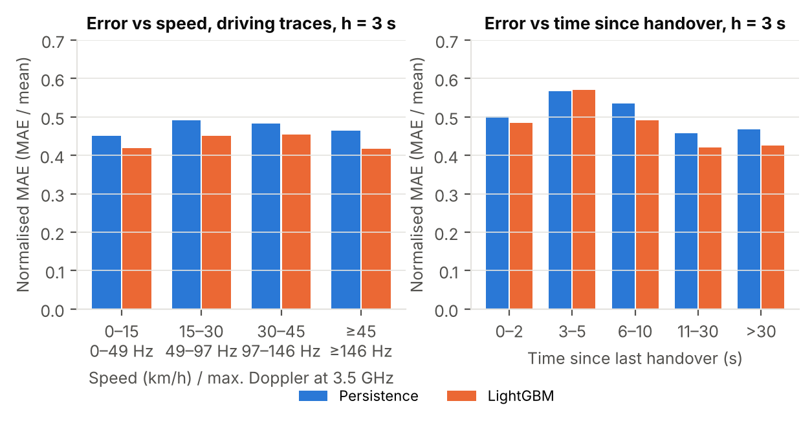

# Spatio-Temporal 5G QoS Forecasting & Real-Time Monitoring

Forecasting the **downlink throughput of a commercial 5G network 1, 3 and 5 seconds ahead**, from real measurements (radio KPIs, GPS position, speed, handovers), with **calibrated prediction intervals**, a **video-streaming use case** and a **real-time monitoring stack** (FastAPI + InfluxDB + Grafana) that raises alerts when a QoS drop is predicted.

📄 **Full paper (IEEE-style, 7 pages):** [`docs/5G_QoS_forecasting_paper.pdf`](docs/5G_QoS_forecasting_paper.pdf) — LaTeX source in [`docs/latex/`](docs/latex/) (compile with XeLaTeX).

[](https://www.linkedin.com/in/sabrineassili74/)    

## Why

Video players, connected cars and remote-driving systems need to know the throughput they will get **in the next seconds**, not just now ("predictive QoS", standardised by 3GPP NWDAF and promoted by 5GAA for vehicles). This project asks three questions on real 5G data:

1. **Accuracy** – can a model beat the trivial forecast "the next seconds look like now" (*persistence*) on drives it has never seen?
2. **Information** – what helps beyond past throughput: radio KPIs, mobility (speed, **Doppler shift**, handovers), or **space–time** information (where the vehicle will be in *h* seconds)?
3. **Usefulness** – are the forecasts' uncertainty intervals reliable, and does a real application benefit?

## Key results (5-fold CV, whole drives held out)

| | 1 s | 3 s | 5 s |
|---|---|---|---|
| Persistence MAE / RMSE (Mbit/s) | 14.32 / 33.82 | 21.23 / 44.63 | 27.37 / 53.82 |
| **LightGBM** MAE / RMSE (Mbit/s) | **13.86 / 28.67** | **17.84 / 33.72** | **20.62 / 37.88** |
| Skill vs persistence (MAE / RMSE) | 3 % / 15 % | 16 % / 25 % | 25 % / 30 % |

- LightGBM beats persistence in **all 15 fold × horizon pairs**; gains grow with the horizon.
- **History carries most of the signal.** Radio and mobility features help **right after handovers**, where they turn a model worse than persistence (15.27) into one better than it (14.60).
- The **space–time prior** (median throughput of other drives at the position predicted *h* s ahead) does **not** improve accuracy on this dataset — an honest negative result, discussed in the paper.
- Normalised error does **not** grow with speed: at ≤ 288 Hz Doppler the channel coherence time is a few ms, so 1-s KPIs average fast fading out.
- **Conformal calibration (CQR)** brings the coverage of 80 % intervals from 72.0 % to 78.0 % on unseen drives.
- **Video streaming:** using the forecast instead of the classic harmonic-mean estimator raises mean bitrate from 11.1 to 18.2 Mbit/s and QoE on **19 of 21 traces**; the CQR lower bound gives the fewest stalls.

<p float="left">
  
  
</p>



<p float="left">
  
  
</p>

## Data

[5G production dataset](https://github.com/uccmisl/5Gdataset) — Raca et al., *ACM MMSys 2020*: real measurements from a major Irish operator (Cork, Dec 2019 – Feb 2020), logged ~1/s with G-NetTrack Pro: GPS, speed, cell ID, technology (5G NSA / LTE / 3G), RSRP, RSRQ, SNR, CQI, RSSI, downlink throughput.

Only the **21 continuous file-download traces** (16 driving, 5 static, 45,768 s) are used: in the Netflix/Amazon traces the throughput is set by the video player (74 % zero seconds for Netflix), not by the network. The dataset is downloaded automatically on first run.

## Method in one picture

```
measurements (1 s) ─► features at t (past only)          ─► LightGBM point forecast  ─► evaluation (held-out drives)
                       history │ radio │ mobility │ space   └► quantile LightGBM + CQR   MAE, RMSE, skill, coverage,
                       target = mean throughput over (t, t+h]                            ablation, video-streaming QoE
```

- **Leakage-free:** whole traces held out; space prior re-learned per fold; filled seconds never scored; unit test checks that future data never changes past features.
- **Doppler:** `f_D = v / c · f_c` (3.5 GHz for 5G n78, 1.8 GHz for LTE).
- **Space–time prior:** ~110 m grid of median throughput from training drives, read at the current position and at `p̂(t+h) = p(t) + h·v̂(t)`.
- **CQR:** quantile LightGBM (10 % / 90 %) widened by a conformal correction computed on calibration drives.

## Real-time monitoring (Docker)

```
replayer (held-out drive, 1 sample/s) ─► FastAPI /predict ─► InfluxDB ─► Grafana dashboard + alert
```

```bash
docker compose up --build
```
Then open **http://localhost:3000** (admin / admin). The dashboard shows measured vs forecast throughput with the 80 % interval, a map of the vehicle coloured by throughput, SNR/CQI/RSRP, speed and serving cell, and a **QoS status** that turns red when the lower bound of the 3-s forecast drops below 10 Mbit/s (Grafana alert rule *Predicted QoS drop*). The API alone is at http://localhost:8000/docs.

Without Docker, the API and the replayer run locally:
```bash
pip install -r realtime/requirements.txt
# terminal 1
set PYTHONPATH=src            # Linux/Mac: export PYTHONPATH=src
uvicorn app:app --app-dir realtime/api --port 8000
# terminal 2
set PYTHONPATH=src            # Linux/Mac: export PYTHONPATH=src
python realtime/replayer/replay.py --dry-run
```

## Reproduce everything

```bash
pip install -r requirements.txt
python scripts/run_experiments.py   # all experiments (~6 min)  -> results/*.csv
python scripts/train_final.py       # deployable model           -> models/qos_forecaster.joblib
python scripts/make_figures.py      # all figures                -> results/figures/
python -m pytest -q                 # 6 tests
```

## Project structure

```
src/qosf/          data.py · features.py · models.py · conformal.py · abr.py · service.py
scripts/           run_experiments.py · train_final.py · make_figures.py
realtime/          api/app.py · replayer/replay.py · grafana/provisioning/ · Dockerfile · demo_trace.csv
results/           metrics.csv · ablation.csv · uncertainty.csv · abr_summary.csv · figures/
models/            qos_forecaster.joblib (trained on all drives except the demo drive)
docs/              IEEE-style paper (PDF) + LaTeX source
tests/             leakage, target, Doppler, ABR and API tests
docker-compose.yml
```

## Limitations

One operator, one city, 21 download traces, NSA 5G (2019–2020); carrier frequencies for Doppler are assumed; ~1 Hz phone-reported KPIs; default hyperparameters; the real-time stack is demonstrated with a replayed drive.

## Author

**Sabrine Assili** — Telecommunications engineering student, ENET'Com Sfax (Automotive Connectivity Engineering) · [LinkedIn](https://www.linkedin.com/in/sabrineassili74/) · [GitHub](https://github.com/Sabrine74)

Dataset: D. Raca, D. Leahy, C. J. Sreenan, J. J. Quinlan, "Beyond Throughput, the Next Generation: A 5G Dataset with Channel and Context Metrics," ACM MMSys 2020.

## License

MIT — see [LICENSE](LICENSE).
